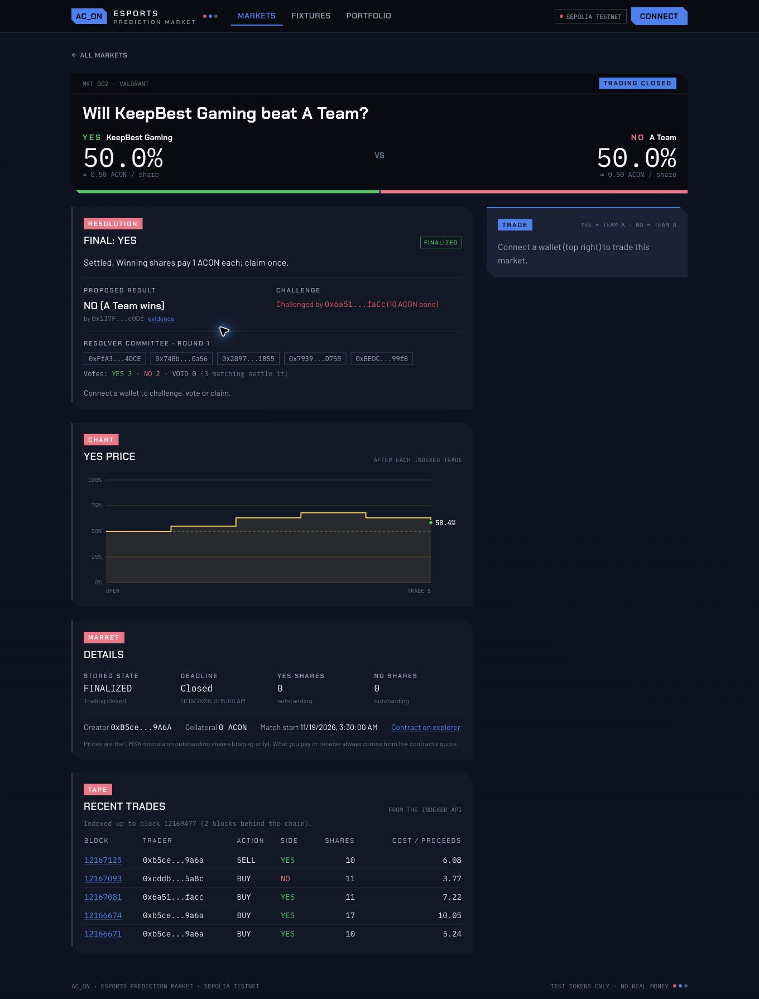

# Market 2 public cross-layer verification — November 19, 2026

Result: **pass** for issue #56's public Sepolia lifecycle. The existing market 2 transactions
were reconciled against contract reads, shared Supabase projections, the public Render API,
and the actual Vercel market page. No new transactions or wallet signatures were requested.

- Frontend: https://acon-esports-market.vercel.app/#/markets/2
- API: https://ac-on-esports-prediction-market.onrender.com
- Chain: Ethereum Sepolia, 11155111.
- Market contract: `0x03ae48f03C7822540a91DA2168602bd49dC510E9`.
- Verification source: `dev` commit `52ca00146db958198e138327437b645ff6b882e8` (merged PR #71).
- Evidence window: November 19, 2026, 16:04–16:12 UTC (11:04–11:12 EST).

## Indexer recovery and preservation

The explicitly selected `backend/.env` connection was used without publishing its values.
The confirmed-event indexer resumed from safe block **12,167,172**. Its first pass committed
**17 logs in 229 ten-block-or-smaller batches**, reaching safe block **12,169,453**. Sixteen
logs belong to market 2's post-trading lifecycle; the other is a legitimate market 1 buy.
The immediate repeat processed **zero logs**, reaching safe block 12,169,460. A later
freshness refresh reached **12,169,477**, again processing zero logs on both passes.

No rebuild, migration, registrar/proposer process, or transaction submission was needed.
Source, review, registration, proposal-intent, fixture-registration and market row counts
were preserved. Market 0's recorded row was unchanged. A final database snapshot confirmed
that the freshness refresh did not add or change the recorded event/position counts.

Evidence: [sync results](indexer-sync.json), [database snapshots](database-verification.json).

## Receipt, contract, database and API comparison

| Check | Result |
|---|---|
| Market state | `FINALIZED`, outcome `YES` (0), 0 YES and 0 NO outstanding; source block 12,169,256 |
| Complete market event stream | All **22** market 2 receipt events match the database payload, hash, log index and block identity |
| Public event APIs | All **21** trade/resolution/claim events match the public API: 5 history, 12 resolution, 4 claims; creation is represented by the market row |
| Reviewed proposal/challenge | Recorded NO proposal and valid 10 ACON challenge match events and API. The intentionally incorrect proposal is labeled as the test input |
| Real VRF | Request ID and callback match; round 1 fulfilled; five distinct committee members belong to the frozen eight-candidate pool |
| Votes and settlement | Five votes produce YES 3 / NO 2 / VOID 0; final YES and 28 ACON winning liability match settlement |
| Claimed positions | All three DB/API positions are claimed with zero shares and the correct claim block; contract `hasClaimed` is true and `claimableAmount` is zero |
| Payouts | 17 + 11 + 0 ACON; each historical wallet delta matches its receipt |
| Duplicate claim | Read-only `eth_call` from the creator returns `AlreadyClaimed`; no duplicate transaction sent |
| Trade guards | All four historical buy quotes and the sell quote match the receipt amounts and ACON transfers; the original calldata caps/minimum are honored |
| Bond refund | Exact 10 ACON debit at challenge and refund at settlement; challenger returns to its pre-challenge balance; escrow zero |
| Surplus | Exact 26.876405572741439440 ACON transfer and creator wallet delta; remaining liability, collateral and withdrawable surplus zero |
| Public deployment | Health/database, exact frontend CORS origin, chain/address/deployment block/ABI identity pass; recorded age 39 seconds and reported lag 2 blocks |

The sell quote at the preceding block and actual proceeds are both
**6.081731240803238806 ACON**. Its submitted minimum is **6.020913928395206417 ACON**.
Amounts in the JSON records are exact base units, not floating-point approximations.

An independent follow-up review of the proposal's
[evidence source](https://egamersworld.com/valorant/match/fyQReleD60/keepbest-gaming-vs-a-team-ZD59-Lj4XM)
confirmed KeepBest Gaming won 2–0, consistent with settled YES. This is a controlled testnet
exercise: the team deliberately submitted NO and scripted the divided committee; it does
not establish independent ownership of the resolver wallets. The source-provider catalog's
stale scheduled status is not treated as authoritative for the result or contract lifecycle.

Evidence: [exact reconciliation](reconciliation.json), [public API responses](public-api.json),
[public-stack smoke](public-smoke.json).

## Actual hosted UI

Chrome opened the public Vercel page without a connected wallet. After contract reads
completed, the page showed **FINAL: YES / FINALIZED**, the original NO proposal, the
challenger and 10 ACON bond, five committee addresses, **YES 3 / NO 2 / VOID 0**, trading
closed, zero YES/NO shares, and **0 ACON collateral**. The five-row indexed trade tape and
chart matched the recorded trades; the indexer label showed block **12,169,477** with a
two-block reported lag and no stale warning in the saved view. Display amounts are rounded.



The [accessibility snapshot](hosted-market2-ax.txt) records the visible fields and all five
receipt links. Holder-specific connected-wallet portfolio screens were not exercised;
exact per-holder claim amounts were verified through contract reads, wallet deltas and the
public portfolio API. No MetaMask connection, signature or transaction was needed, and this
check does not change the public domain's separate wallet-security classification.

On fresh page load the resolution temporarily displayed `FINAL: ?` until its separate RPC
reads completed; it recovered automatically to the correct YES result and committee. The
saved acceptance view was taken after those reads completed. The local indexer was used for
bounded verification passes and is not left running: continued freshness still requires the
team's operator process. This is dated acceptance evidence, not an uptime guarantee.

## Recheck

Run the existing confirmed-event indexer from a correctly configured `backend/.env`:
`python -m app.indexer.worker --once`. Confirm no other indexer owns the same deployment.
The PostgreSQL URL must use the application's SQLAlchemy driver form
`postgresql+psycopg://`; no credentials belong in this document or a command copied to chat.

Then run the existing read-only public smoke from the repository root:

```sh
backend/.venv/bin/python backend/scripts/smoke_public.py \
  --api-base-url https://ac-on-esports-prediction-market.onrender.com \
  --frontend-url https://acon-esports-market.vercel.app \
  --manifest deployments/sepolia-2026-11-02/manifest.json
```

Compare the saved receipt identities with `/api/v2/markets/2`, `/history`, `/resolution`,
`/claims`, and `/api/v2/portfolio/{holder}`. Open the public market page and wait for the
contract-backed resolution/committee fields before checking the visible state. Local Anvil
runs remain separate evidence; none were used to substitute for these public checks.
