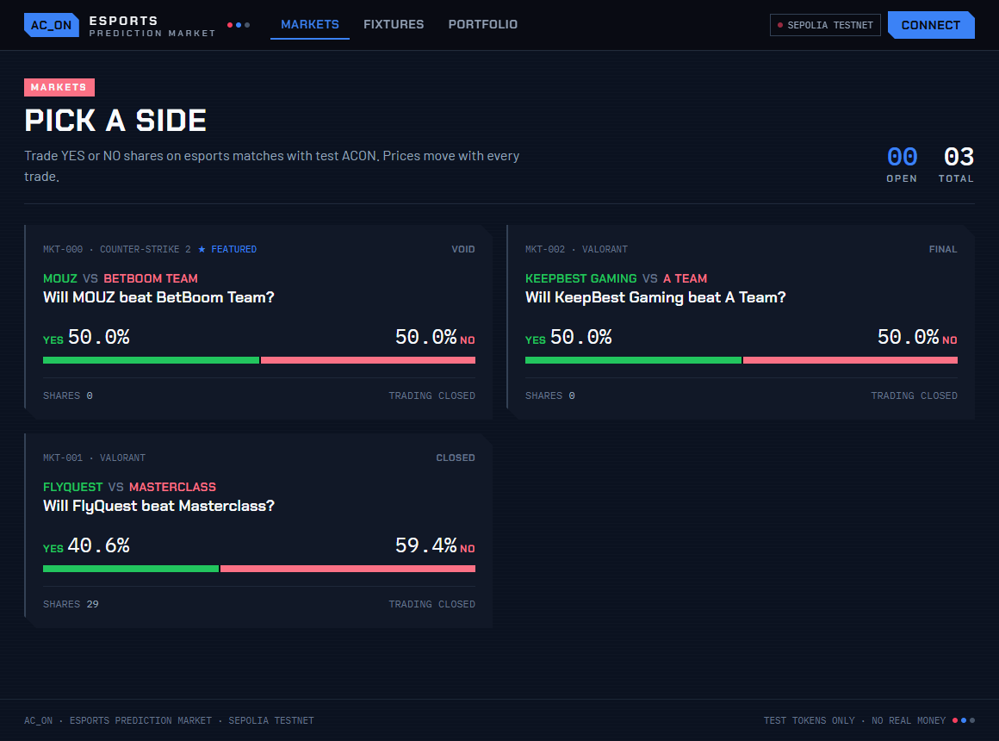
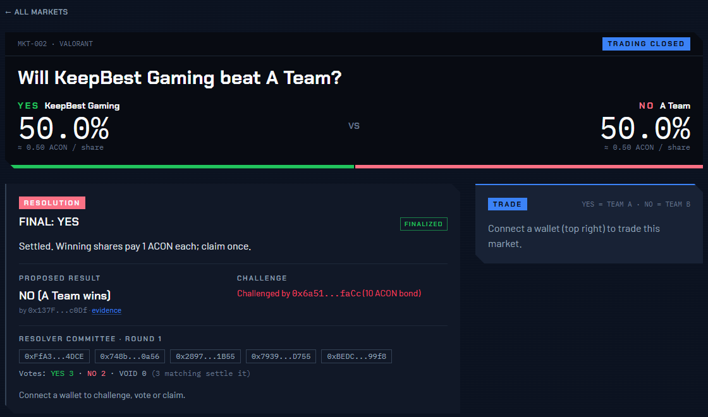

# AC_ON User Guide

Status: Milestone 5 draft, updated November 21, 2026; to be finalized for Milestone 6. Public site:
**https://acon-esports-market.vercel.app** (Ethereum Sepolia testnet), backed by the hosted API at
https://ac-on-esports-prediction-market.onrender.com. Screenshots were taken from the public site on
November 20, 2026, with no wallet connected.

## What AC_ON Is

AC_ON is an esports prediction market on the Ethereum Sepolia testnet. Each market asks one
question, such as "Will FlyQuest beat Masterclass?". YES backs Team A and NO backs Team B. Prices come
from an LMSR market maker and move with every trade. It is for players and fans who want to try a
decentralized prediction market with free test ACON instead of real money. The smart contracts, not
the website, the backend or PandaScore, hold positions, decide the result and pay out.

The header has three pages: **Markets**, **Fixtures** and **Portfolio**. The `SEPOLIA TESTNET` label
confirms which network the site expects, and **Connect** (top right) opens the wallet menu.

## Before You Start

1. Install MetaMask and create a disposable testnet-only account. Never use a wallet that holds real
   assets, and never share a recovery phrase or private key. A public address is safe to share.
2. Select Ethereum Sepolia in MetaMask and get a small amount of Sepolia ETH from a public faucet for gas.
3. Open https://acon-esports-market.vercel.app, select **Connect**, then **MetaMask (browser
   wallet)**, and approve the connection in MetaMask.
4. If the wallet is on another network, a red **Wrong network** bar appears under the header. Select
   **Switch to Sepolia** (or choose Sepolia in MetaMask yourself) before signing anything.
5. Select **Claim 1,000** next to your ACON balance in the header. The faucet gives 1,000 test ACON
   once per address and costs only Sepolia gas.

**Coinbase Wallet** (passkey or email, no extension) can connect and read balances, but on Sepolia it
cannot send transactions. Use MetaMask to claim ACON, trade, challenge, vote or claim payouts.

## Fixtures And Markets

- **Fixtures** lists imported matches from the fixture API. Filter by **Upcoming**, **Finished**,
  **All** and by game. Each row shows the provider status (for example `SCHEDULED`, `POSTPONED`) and
  the on-chain registration status (`NOT REGISTERED`, `REQUESTED`, `REGISTERED`).
- A fixture is not a market. The fixture page keeps the provider observation separate from the
  independent operator review and the confirmed on-chain registration.
- For an eligible reviewed fixture, open it and select **Request on-chain registration**, then sign
  the message in your wallet. This signature is free; the team's restricted registrar submits the
  registration transaction. Registration closes 30 minutes before the scheduled start.
- Registration does not create a market. After confirmation, connect a funded wallet, choose a
  **Trading deadline** (at least 15 minutes before the match starts) and select **Approve subsidy,
  then create market**. The creator funds a subsidy of about 34.66 ACON.

## Trading

**Current demo availability (November 21, 2026):** All three existing Sepolia markets have passed
their trading deadlines. They remain available for read-only inspection, including MKT-002's
completed dispute. To try the trading steps below, a new market must first be created for an
eligible reviewed fixture using the registration and creation flow above.

1. Open a market from **Markets** before its trading deadline. Open markets show `Live` and a
   countdown; others show `Trading closed`.
2. In the **Trade** panel, choose **Buy** or **Sell**, then YES/Team A or NO/Team B.
3. Enter **Shares** (maximum 100 per trade) and **Max slippage %** (0 to 50). The panel shows the
   contract's quote: **You pay at most** for a buy, **You receive at least** for a sell.
4. A first buy shows **Approve ACON, then buy**: confirm the approval, then the buy. Later buys within
   the approved amount need only one confirmation. A sell needs owned shares.
5. Follow the progress bar: **Wallet → Submitted → Mined → Indexed**. Mined means the trade is on the
   chain; indexed means the site's history has caught up after two confirmations.
6. **Your YES** and **Your NO** under the trade button show your current holdings. The **YES price**
   chart updates after each indexed trade, and **Recent trades** links every trade to Sepolia Etherscan.

Prices shown are the LMSR formula on outstanding shares, for display only. What you pay or receive
always comes from the contract's quote, bounded by your slippage limit.

## Results, Challenges, And Resolvers

The **Resolution** panel on each market shows the proposed result, the challenge window, the resolver
committee and vote counts.

- The proposer may submit an independently reviewed YES, NO, or VOID result after trading closes.
- A non-proposer may challenge during the displayed window: enter a reason and select **Approve 10
  ACON, then challenge** (or **Challenge with 10 ACON bond** once approved).
- If nobody challenges before the window closes, anyone may select **Finalize the proposal**.
- After a challenge, or if no result is proposed within seven days of the trading deadline, anyone
  may select **Start resolver selection**. If the draw has not arrived after 30 minutes, **Request
  the committee draw** retries it. Chainlink VRF selects five eligible resolver addresses. Only
  selected resolver wallets may vote.
- Three matching YES, NO, or VOID votes settle the dispute. A failed round may use one replacement;
  exhausted resolution paths end in VOID according to the contract.

*A completed dispute (MKT-002): the proposed NO was challenged, Chainlink VRF chose five resolvers,
and they settled YES 3–2.*

## Claims And Portfolio

- **Portfolio** reads positions and claimability directly from the contract for the connected
  wallet; the indexed backend provides trade history and derived metadata.
- After FINALIZED, winning shares pay one ACON each. After VOID, one combined claim pays
  `floor((YES shares + NO shares) / 2)` ACON base units.
- Select **Claim … ACON** once. Duplicate claims are rejected by the contract and the panel shows
  "You already claimed your payout for this market."
- Losing shares claim 0 ACON, but claiming still closes the position.
- Market creators may select **Withdraw creator surplus** to withdraw only surplus above
  conservative remaining liabilities.

## Mobile

The same pages work on a phone-sized screen. The navigation moves under the logo. Use the MetaMask
mobile app's built-in browser to sign transactions on a phone.

## Common Problems

| Problem | What to check |
|---|---|
| Wrong network | Select **Switch to Sepolia** in the red bar, or choose Ethereum Sepolia in MetaMask and reload. |
| "You rejected the request in your wallet. Nothing was sent." | You cancelled in MetaMask. Nothing changed; try again if you meant to. |
| Transaction reverted | "Your ACON and your position did not change." Check the deadline, your balance and slippage, then retry. |
| Not enough gas | Fund the disposable wallet with Sepolia ETH. |
| Not enough ACON | Claim once from the faucet or reduce the transaction. |
| Coinbase Wallet cannot send | On Sepolia, use MetaMask for transactions. |
| Trading is closed | The market passed its deadline. The contract rejects trades at and after the deadline, so the site disables buy and sell even before the stored state changes. |
| Fixture cannot be registered | Confirm it is independently reviewed, scheduled, unchanged, and more than 30 minutes from its start. |
| Mined but not indexed, or "The indexer worker has not updated for over 2 minutes" | Your trade is already on the chain. Do not resubmit; the history catches up when the indexer runs. Check the transaction on Etherscan. |
| Indexer/API unavailable | The site still reads markets and positions from the contracts. Do not resubmit a successful transaction; check its Etherscan receipt first. |
| Cannot challenge | Confirm the proposal window is open, this wallet is not the proposer, and it has 10 ACON. |
| Cannot vote | Only the five selected resolver addresses can vote, once per round. |

## Evidence And Support

For course testing, record only public URLs, public wallet addresses, transaction hashes, blocks,
and sanitized screenshots. Report reproducible defects using the M5 defect template; never attach
private keys, tokens, database/RPC URLs, or recovery phrases.
