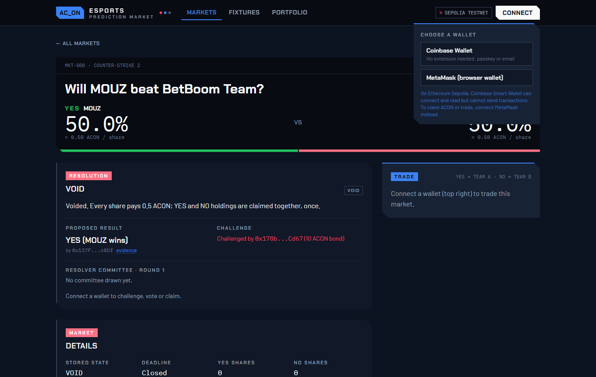
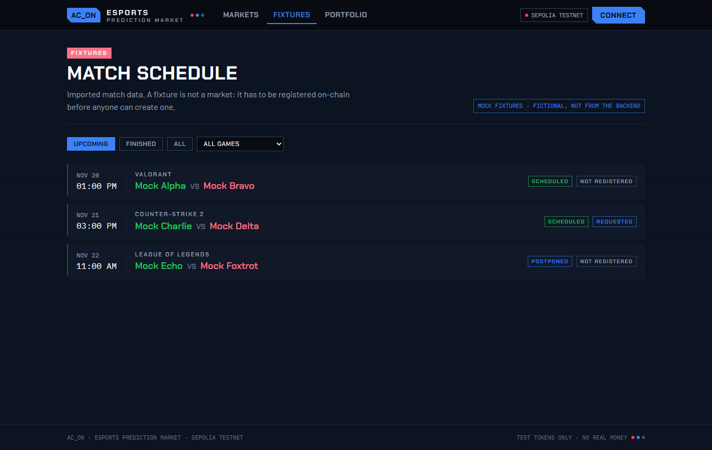
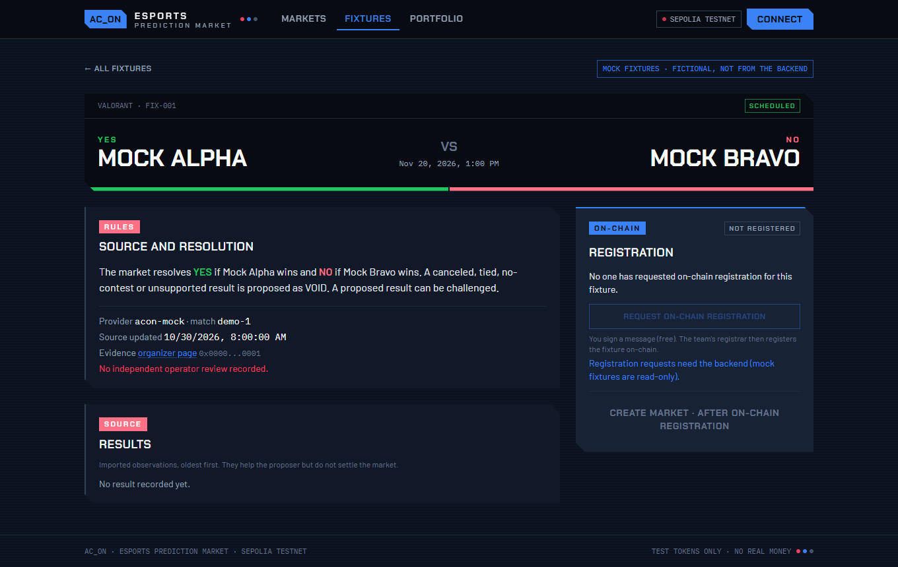
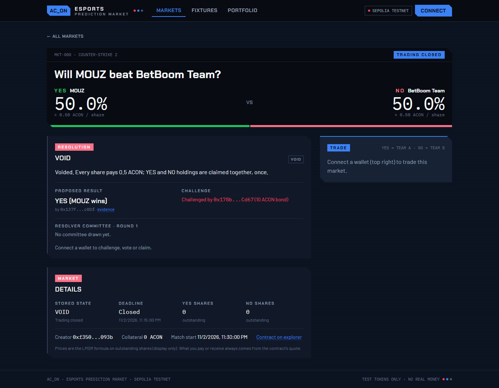
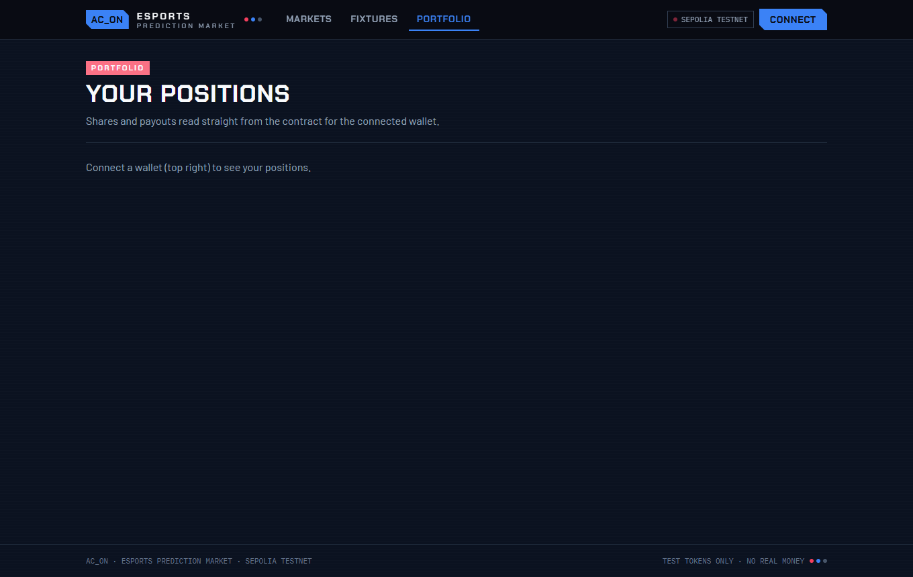
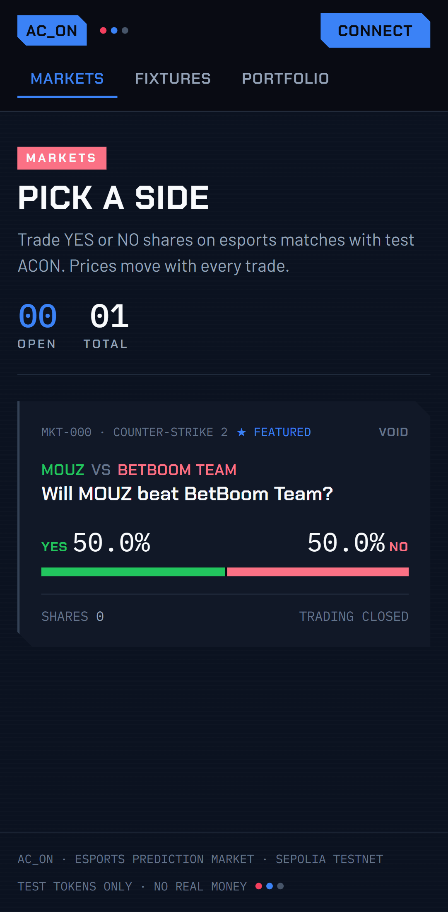

# AC_ON User Guide

Status: Milestone 5 draft, updated November 18, 2026. Public site:
**https://acon-esports-market.vercel.app** (Ethereum Sepolia testnet). Until the hosted backend API is
connected, the site reads markets directly from the contracts, the fixture catalog shows clearly
labeled mock fixtures, and the price chart and recent-trades tape are hidden.

## What AC_ON Is

AC_ON is a Sepolia-only esports prediction market using test ACON. Team A maps to YES and Team B
maps to NO. It does not use real money. Smart contracts, not the backend or PandaScore, determine
positions, resolution, and payouts.

The header has three pages: **Markets**, **Fixtures** and **Portfolio**. The `SEPOLIA TESTNET` label
confirms which network the site expects, and **Connect** (top right) opens the wallet menu.

## Before You Start

1. Install MetaMask and create a disposable testnet-only account.
2. Select Ethereum Sepolia and obtain a small amount of Sepolia ETH for gas.
3. Open https://acon-esports-market.vercel.app, select **Connect**, then **MetaMask (browser
   wallet)**, and approve the connection in MetaMask.
4. If the wallet is on another network, a red bar appears under the header. Select **Switch to
   Sepolia** (or choose Sepolia in MetaMask yourself) before signing anything.
5. Select **Claim 1,000** next to your ACON balance in the header. The faucet works once per address
   and costs only Sepolia gas.

**Coinbase Wallet** (passkey or email, no extension) can connect and read balances, but on Sepolia it
cannot send transactions. Use MetaMask to claim ACON, trade, challenge, vote or claim payouts.

Never share a private key or recovery phrase. A public address is safe to share. Do not use a
wallet containing Mainnet assets for course testing.

## Fixtures And Markets

- **Fixtures** lists imported matches. Filter by **Upcoming**, **Finished**, **All** and by game.
  Each row shows the provider status (for example `SCHEDULED`, `POSTPONED`) and the on-chain
  registration status (`NOT REGISTERED`, `REQUESTED`, `REGISTERED`).
- The fixture catalog shows provider observations separately from independent operator review and
  confirmed on-chain registration. A fixture is not a market.
- For an eligible reviewed fixture, open it and select **Request on-chain registration**, then sign
  the message in your wallet. This signature is free; the restricted registrar submits the
  registration transaction.
- Registration does not create a market. After confirmation, connect a funded wallet, choose a
  **Trading deadline** (at least 15 minutes before the match starts) and select **Approve subsidy,
  then create market**. The creator funds a subsidy of about 34.66 ACON.

While the hosted API is not connected, the catalog shows `MOCK FIXTURES · FICTIONAL, NOT FROM THE
BACKEND`, and registration requests are disabled.

## Trading

1. Open a market from **Markets** before its trading deadline. Open markets show `Live` and a
   countdown; others show `Trading closed`.
2. In the **Trade** panel, choose **Buy** or **Sell**, then YES/Team A or NO/Team B.
3. Enter **Shares** (maximum 100 per trade) and **Max slippage %** (0 to 50). The panel shows the
   contract's quote: **You pay at most** for a buy, **You receive at least** for a sell.
4. A first buy shows **Approve ACON, then buy**: confirm the approval, then the buy. Later buys within
   the approved amount need only one confirmation. A sell needs owned shares.
5. Follow the progress bar: **Wallet → Submitted → Mined → Indexed**. Mining proves the chain write;
   indexing only means the derived backend/UI has caught up after confirmations. Without the hosted
   API, the site says the indexed step is skipped; your shares are still on-chain.
6. **Your YES** and **Your NO** under the trade button show your current holdings.

Prices shown are the LMSR formula on outstanding shares, for display only. What you pay or receive
always comes from the contract's quote, bounded by your slippage limit.

## Results, Challenges, And Resolvers

The **Resolution** panel on each market shows the proposed result, the challenge window, the resolver
committee and vote counts.

- The proposer may submit an independently reviewed YES, NO, or VOID result after trading closes.
- A non-proposer may challenge during the displayed window: enter a reason and select **Approve 10
  ACON, then challenge** (or **Challenge with 10 ACON bond** once approved).
- If nobody challenges before the window closes, anyone may select **Finalize the proposal**.
- After a challenge, or if no result is proposed within seven days of the trading deadline, anyone
  may select **Start resolver selection**. If the draw has not arrived after 30 minutes, **Request
  the committee draw** retries it. Chainlink VRF selects five
  eligible resolver addresses. Only selected resolver wallets may vote.
- Three matching YES, NO, or VOID votes settle the dispute. A failed round may use one replacement;
  exhausted resolution paths end in VOID according to the contract.

## Claims And Portfolio

- **Portfolio** reads positions and claimability directly from the contract for the connected
  wallet; the indexed backend provides trade history and derived metadata.
- After FINALIZED, winning shares pay one ACON each. After VOID, one combined claim pays
  `floor((YES shares + NO shares) / 2)` ACON base units.
- Select **Claim … ACON** once. Duplicate claims are rejected by the contract and the panel shows
  "You already claimed your payout for this market."
- Losing shares claim 0 ACON, but claiming still closes the position.
- Market creators may select **Withdraw creator surplus** to withdraw only surplus above
  conservative remaining liabilities.

## Mobile

The same pages work on a phone-sized screen. The navigation moves under the logo. Use the MetaMask
mobile app's built-in browser to sign transactions on a phone.

## Common Problems

| Problem | What to check |
|---|---|
| Wrong network | Select **Switch to Sepolia** in the red bar, or choose Ethereum Sepolia in MetaMask and reload. |
| "You rejected the request in your wallet. Nothing was sent." | You cancelled in MetaMask. Nothing changed; try again if you meant to. |
| Transaction reverted | "Your ACON and your position did not change." Check the deadline, your balance and slippage, then retry. |
| Not enough gas | Fund the disposable wallet with Sepolia ETH. |
| Not enough ACON | Claim once from the faucet or reduce the transaction. |
| Coinbase Wallet cannot send | On Sepolia, use MetaMask for transactions. |
| Fixture cannot be registered | Confirm it is independently reviewed, scheduled, unchanged, and not too close to start. |
| Mined but not indexed | Wait for two confirmations; the chain state remains authoritative. |
| Indexer/API unavailable | Do not resubmit a successful transaction. Check its Etherscan receipt first. |
| Cannot challenge | Confirm the proposal window is open, this wallet is not the proposer, and it has 10 ACON. |
| Cannot vote | Only the five selected resolver addresses can vote, once per round. |

## Evidence And Support

For course testing, record only public URLs, public wallet addresses, transaction hashes, blocks,
and sanitized screenshots. Report reproducible defects using the M5 defect template; never attach
private keys, tokens, database/RPC URLs, or recovery phrases.

Screenshots in this guide were captured from the public site on November 18, 2026, with no wallet
connected.
