# Current contract ABI draft

Status: **local implementation draft authorized by Benny; not a team-frozen ABI or deployed release**.
The approved [M4 decision](M4_FEATURE_COMPLETE_INTERFACE.md) remains authoritative. Matthew,
Adriel, and Yudhveer must review the exact generated ABI, numeric behavior, and event fields
before dependent releases. Matthew's economic proof/payout sign-off remains a merge gate.

## Local clarifications approved by Benny

- Entering resolver selection starts its fixed seven-day deadline immediately. If fewer than
  five eligible addresses exist, the pool may be replenished. Freeze the first viable pool
  at the first VRF request attempt; subsequent requests use that snapshot and deadline.
- Oracle proposals must arrive strictly before `tradingDeadline + 7 days`, even if no caller
  has yet advanced the expired state. At the cutoff only resolver selection is available.
- Positive sells with nonpositive rounded cost decrease revert with `TradeTooSmall`.
- For the rounding correction, preserve the mathematical floor for sells and use the matched
  mathematical ceiling for buys. Benny authorized this local numeric correction after the
  reverse-trade gain was identified. Matthew and consumers must approve it before merge.
- The product is updated in place under `contracts/src/`, with a single `PredictionMarket`.
  `MarketPricing` uses directed mathematical bounds; Matthew's economic review remains required.
  Tests are grouped by behavior under `contracts/test/`, and `contracts/script/Deploy.s.sol`
  deploys the current product. Previous on-chain deployment records retain their original ABIs.

## Exact handoff files

- [Generated function/event/error/tuple reference](CONTRACT_ABI_REFERENCE.md): exact Solidity types,
  indexed positions, and tuple field order for all four production contracts.
- [`deployments/`](../../../deployments/): current compiled JSON ABIs under `abi/`,
  `build.json` with source/dependency/ABI/runtime-template SHA-256 digests, and actual Anvil event examples.
- [Verification and static-analysis review](../testing/CONTRACT_VERIFICATION.md).
- [Deployment and Safe/VRF runbook](../CONTRACT_DEPLOYMENT.md).

The current `build.json` is a review artifact, **not a live deployment manifest**. Its deployment
addresses are null. Previously deployed ABIs cannot decode the current market tuple or state enum. Configure
contract address, ABI version, deployment block, and enum mapping together at integration.

## Types and numeric units

| Value | Meaning |
|---|---|
| Market state (`uint8`) | `OPEN=0`, `CLOSED=1`, `PROPOSED=2`, `DISPUTED=3`, `RESOLVER_SELECTION=4`, `RESOLVER_VOTING=5`, `FINALIZED=6`, `VOID=7` |
| Trade outcome (`uint8`) | `YES=0` (Team A), `NO=1` (Team B); no VOID trade |
| Resolution choice (`uint8`) | `YES=0`, `NO=1`, `VOID=2`; applies to proposals and votes |
| ACON, shares, quotes, payments, liabilities | Integer base units; `1e18` = one ACON or one share. Preserve as integers/decimal strings, never floating point |
| Subsidy / challenge bond | `34657359027997265471` / `10000000000000000000` ACON base units |
| Trade / aggregate quantity bound | `100e18` per buy/sell; `2000e18` outstanding shares per side |
| Times | Unix seconds; 900-second start margin, 86,400-second challenge, 604,800-second no-proposal/selection, 172,800-second vote, 1,800-second retry |
| IDs and counts | Unscaled integers; markets begin at zero. Resolution round `0` means none, then `1` or `2` |
| VRF request ID | Full `uint256`; use `hasRequest`/`exists`, not `id != 0`, to detect presence |

`getMarket(id)` returns **one Market tuple**, in this order:
`(id, fixtureKey, question, tradingDeadline, state, creator, yesQuantity, noQuantity, collateralBalance)`.
Its final two quantities are outstanding, unclaimed holdings; claims decrement them. Use events
for historical trading totals. A nonexistent market reverts on semantic reads. Plain mapping
getters (`hasClaimed`, `hasTraded`, `hasVoted`, `vrfRequests`) return their Solidity defaults for
missing keys. An unstarted resolver round returns a zero/empty round; first read `getResolution`.

Solidity rejects out-of-range enum inputs before the function body. Clients should validate
them and handle generic reverts; there is no custom `InvalidOutcome` error.

## Fixtures and creation

`computeFixtureKey(providerId, gameId, externalMatchId)` uses ordinary Solidity
`keccak256(abi.encode(string,string,string))`, **not** packed encoding, JSON hashing, or string
concatenation. The contract does not lowercase, trim, or otherwise normalize these strings.
The registrar and catalog must use identical normalized provider identifiers.

`registerFixture(FixtureData)` requires the registrar role, distinct nonempty team IDs,
nonempty team names/identity, future start beyond the 15-minute margin, and a nonzero evidence
hash with a nonempty URI. It emits the complete fixture data. Corrections before funding replace
the record, while all historical registrars remain recorded for resolver conflict exclusion.
After funding, all registered metadata is locked. Off-chain postponement/status updates must
not be represented as changes to the funded fixture or a reopened trading window.

The returned fixture includes `revisionHash = keccak256(abi.encode(FixtureData))`.
Creation requires this exact revision as `expectedFixtureHash`, preventing a transaction from
silently accepting changed team/start metadata. Encoding a single dynamic struct is different
from encoding its fields as separate top-level arguments: use the compiled tuple ABI.

Anyone may approve the fixed subsidy and call `createMarket(key, deadline, revisionHash)`.
The deadline must be strictly future and at most `scheduledStart - 900`. One funded market is
allowed per fixture; `hasMarket` disambiguates market ID zero. Funding failure rolls back the
ID, fixture lock, collateral, and token movement. YES/NO follow registered team order.

## Trading and accounting

`quoteBuy`/`buy` use the ceiling of the mathematical LMSR cost increase; `quoteSell`/`sell` use
the floor of the mathematical cost decrease through immutable `MarketPricing`. Both directions require stored OPEN and time strictly
before the deadline. Sell execution additionally checks the caller owns the shares; its quote
is market-wide and does not certify caller ownership. Quotes are indicative, not reservations.

Buy recomputes `cost <= maxCost`; sell recomputes `proceeds >= minReturn`. Buy collects only
actual cost; sell pays only actual proceeds. A positive sale whose mathematical cost-difference
floor is zero reverts as `TradeTooSmall`; positive buys round up to at least one base unit. `LMSRBounds` encloses the real
difference before base-unit rounding; if the bounds do not certify floor and ceiling it reverts
`PricingPrecisionExceeded`. An immediate reverse trade retains zero base units for exact-integer
prices, otherwise one. There is no platform fee or arbitrary rounding buffer. See the
[numerical method, regression vectors and collateral argument](../testing/PRICING_ROUNDING.md).
Matthew must review the calculation and adapt the sell-inclusive proof for this pricing model
before payout code merges. The original rounded-potential `LMSR.buyCost` remains a historical
primitive; the current market no longer uses it to quote executable trades.

Market accounting/positions update before token interactions under a shared reentrancy lock.
Failed/false-returning or unexpected token transfers revert atomically. Deployment fixes the
supplied fee-free, non-rebasing ACON; arbitrary ERC-20 compatibility is not asserted. There are
no transferable share tokens, user-on-behalf-of writes, or payable market functions.

`totalCollateral` is the sum of market collateral balances; `totalChallengeBonds` is separate
escrow. Successful intended flows preserve token balance = collateral + bonds. Unsolicited
direct ACON transfers can make token balance larger; they do not credit market collateral and
there is no administrative sweep. Never infer a particular market's surplus from global balance.

## Calls, roles and transitions

| Call | Caller / condition | Effect |
|---|---|---|
| `registerFixture` | Registrar role | Register/correct an unfunded fixture |
| `createMarket`, `buy`, `sell` | User with funds/shares and required allowance | Caller-owned market/position accounting |
| `closeTrading` | Anyone at/after deadline; registrar with evidence before it | OPEN → CLOSED; early close sets deadline to current timestamp |
| `proposeOutcome` | Proposer role; after close, strictly before deadline + seven days | OPEN (if expired) / CLOSED → PROPOSED, one immutable proposal |
| `challengeOutcome` | Anyone except the proposal's author, strictly before challenge deadline | PROPOSED → DISPUTED; first 10 ACON bond only |
| `finalize` | Anyone at/after challenge deadline, still PROPOSED | Proposal becomes FINALIZED or VOID |
| `requestResolverSelection` | Anyone from DISPUTED, or OPEN/CLOSED at/after no-proposal cutoff | Start round 1; selection deadline starts immediately |
| `retryResolverSelection` | Anyone during selection | Request/retry without resetting deadline/snapshot |
| `rawFulfillRandomWords` | Immutable coordinator only | Current valid callback selects committee and opens voting |
| `voteOnOutcome` | Selected resolver, once per round, before vote deadline | Third matching vote settles |
| `advanceResolution` | Anyone at expired selection/voting deadline | Selection expiry → VOID; round 1 voting expiry → round 2; round 2 voting expiry → VOID |
| `claimPayout` | Holder, once per terminal market | Combined entitlement consumed and payout sent to caller |
| `withdrawCreatorSurplus` | Market creator, terminal state | Withdraw only collateral above remaining liabilities |
| Registry `setResolverStatus` | Registry administrator | Change eligibility for future snapshots |
| Role grant/revoke and admin transfer | Respective contract administrator | Role recovery / two-step Safe handoff |

The registrar has no future-deadline-edit or reopen method; its supported shortening operation
is immediate evidence-backed closure. Early closure also moves the no-proposal cutoff because
that cutoff is based on the stored trading deadline.

```mermaid
stateDiagram-v2
    [*] --> OPEN: registered fixture + subsidy
    OPEN --> CLOSED: closeTrading / lazy close after deadline
    CLOSED --> PROPOSED: authorized immutable proposal
    PROPOSED --> DISPUTED: first bonded challenge before cutoff
    PROPOSED --> FINALIZED: unchallenged YES/NO after 24h
    PROPOSED --> VOID: unchallenged VOID after 24h
    CLOSED --> RESOLVER_SELECTION: no proposal for seven days
    DISPUTED --> RESOLVER_SELECTION: permissionless request
    RESOLVER_SELECTION --> RESOLVER_VOTING: current timely VRF callback
    RESOLVER_SELECTION --> VOID: seven-day formation deadline
    RESOLVER_VOTING --> FINALIZED: three YES or three NO
    RESOLVER_VOTING --> VOID: three VOID / round 2 expires
    RESOLVER_VOTING --> RESOLVER_SELECTION: round 1 expires; start round 2
    FINALIZED --> FINALIZED: claims / creator surplus
    VOID --> VOID: claims / creator surplus
```

Calls may close OPEN and advance it again within the same transaction. Passage of time alone
does not change stored state. CLAIMABLE is derived, not an enum member. Default `proposal` or
`finalOutcome` zero is not an actual YES decision without `proposed` or `terminal` respectively.

## Resolver and callback semantics

The allowlist contains unique addresses. Eligibility excludes the registry's current admin,
creator, every registrar of this fixture, proposal author, challenger, historical traders,
and current holders. Checks operate on addresses, not human identities. `isResolverEligible`
reports current registry/conflict eligibility; it does not override an already-frozen round.
`isSelectedResolver` and the stored committee determine voting authority.

A round with fewer than five eligible candidates emits `ResolverSelectionPending`; there is
no VRF request yet, and replenishment/retry is immediate within the existing deadline. The
first viable pool is frozen before attempting the coordinator call. A failed call emits
`ResolverSelectionRequestFailed` and retains the snapshot and last-attempt time. Subsequent
attempts must wait 30 minutes. Retrying supersedes the prior request even when the new attempt
fails; callers must inspect `hasRequest` and emitted events, not just transaction success.

VRF v2.5 requests use one word, three confirmations, and `nativePayment=false` encoded using
`VRF ExtraArgsV1`. Only the configured coordinator can call the consumer. Five distinct
committee members are sampled without replacement; modulo rejection avoids selection bias.
Voting starts at fulfillment time and lasts 48 hours. Allowlist changes cannot rewrite a
frozen pool or revoke an assigned vote. A replacement round takes a fresh pool and excludes
round-1 committee members if at least five other eligible addresses exist.

`VRFFulfillmentIgnored.reason` is `UNKNOWN_REQUEST=0`, `SUPERSEDED=1`, `CONSUMED=2`,
`WRONG_PHASE=3`, `EXPIRED=4`, `INVALID_WORD_COUNT=5`. An unknown ID emits default market/round
zero: do not associate that event with market zero without checking request existence.
Invalid callbacks do not mutate the round. An unauthorized caller reverts `OnlyCoordinator`.
Retries cannot extend selection; callbacks/votes at the exact deadline are too late.

## Settlement and claims

- Final YES/NO reserves and pays one ACON per outstanding winning share.
- VOID reserves `ceil((yesQuantity + noQuantity) / 2)` and each wallet receives
  `floor((yesShares + noShares) / 2)` base units, combining both holdings in one claim.
- A claim marks `hasClaimed`, clears both positions, decrements outstanding quantities and
  collateral, then transfers. Losers or sub-base-unit VOID holdings may consume a zero-value
  claim; a wallet with no shares reverts `NoPosition`. Duplicate claims revert `AlreadyClaimed`.
- Final outcome different from proposal refunds the bond. An upheld proposal moves the bond
  into that market's collateral. Both occur atomically with settlement. A failed refund rolls
  back finalization, including a third vote, so it can be retried.
- Creator withdrawal is allowed before all holders claim **only** above the remaining liability.
  Conservative VOID dust becomes withdrawable as claims remove obligations. Preterminal
  `withdrawableSurplus` and `claimableAmount` return zero.

## Event consumption and errors

The generated reference is authoritative for fields/indexing; the human-readable event list
in the target decision is not a decoding schema. Trade/sell events contain actual payment and
post-trade quantities. `PayoutClaimed` contains consumed YES/NO shares, payout, and remaining
liability. Finalization and bond-disposition events are separate. VOID uses `MarketVoided`,
not an extra `MarketFinalized` event. Fixture registration includes the full dynamic tuple.

`event-fixtures.anvil.json` supplies actual log envelopes, canonical signatures, and decoded
nonindexed values in ABI order. Indexed values remain in `topics` (topic zero is the signature).
Preserve chain/address/block hash/transaction hash/log index and confirmed-log identity. M4's
default indexer depth of two is distinct from VRF's three request confirmations. Mined success
and confirmed indexing remain separate UI statuses.

Include the market, pricing, and token error ABIs when decoding reverts. Validation errors
include `FixtureRevisionMismatch`, `WrongState(actual)`, `ProposalExpired`, `RetryTooSoon`,
and `VotingClosed`. Trade guards use `SlippageExceeded(actualCost,maxCost)` and
`MinimumReturnNotMet(proceeds,minReturn)`. Token errors/reverts can propagate; generic errors
must remain supported. Full signatures are generated rather than duplicated here.

### Review handoff

Matthew reviews mathematical bounds, matched ceil-buy/floor-sell rounding, terminal liabilities, bond disposition, dust and
surplus. Adriel reviews tuple/enum decoding, guarded user writes and derived claimability.
Yudhveer reviews fixture encoding/revisions, restricted calls, indexed event fields, ignored
callbacks and reorg-safe projection. Record their approvals against the exact ABI/source
digests before declaring the interface frozen.
