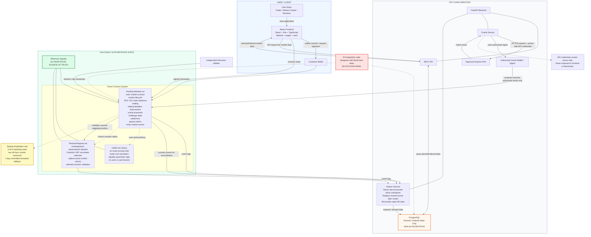
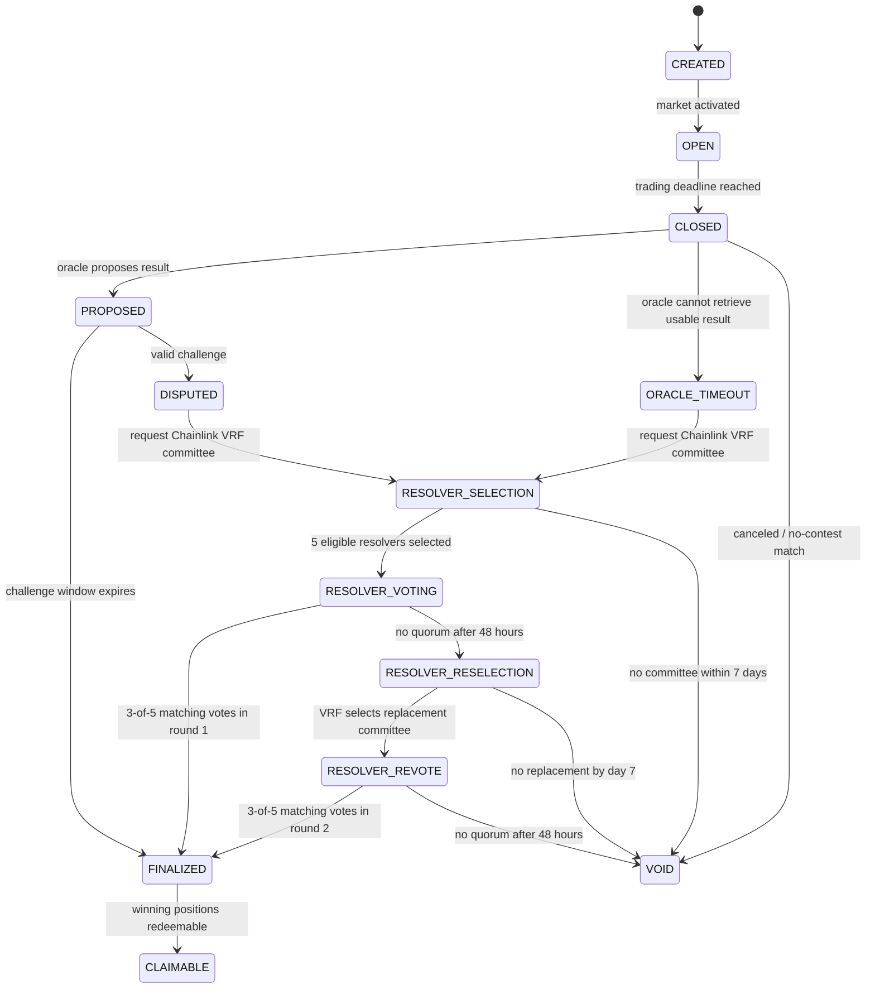
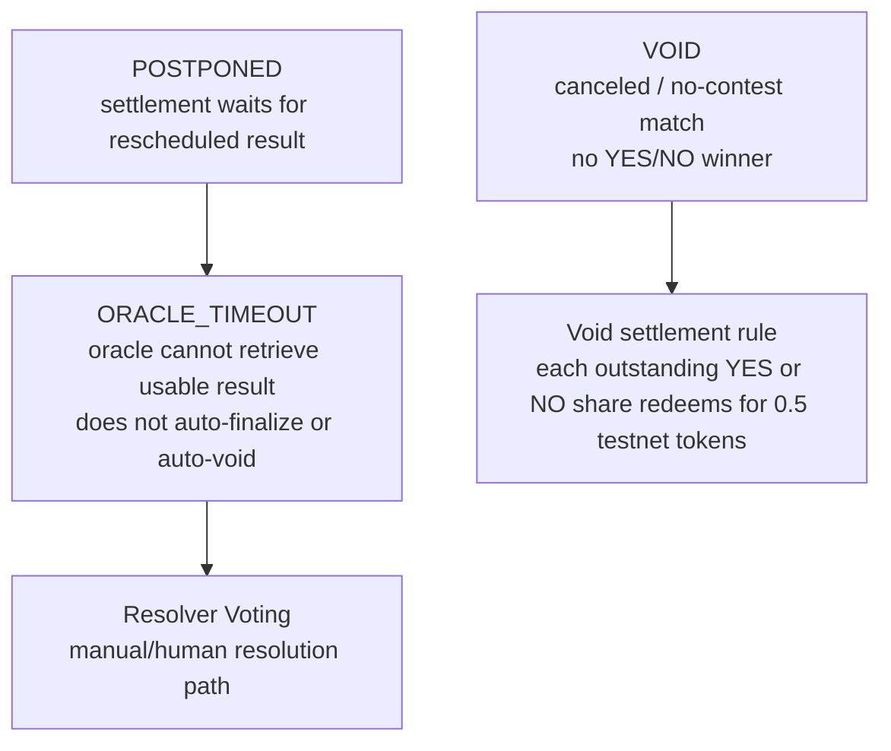

# AC_ON Architecture Preview

AC_ON is a testnet-only decentralized esports prediction market. Users connect Coinbase Wallet and trade YES/NO shares on binary esports match outcomes.

Milestone 3 market creation, LMSR quotes, and guarded buys are deployed on Ethereum Sepolia, with a confirmed ten-share YES smoke test. The [deployment manifest](../deployments/sepolia-m3.json) and [verification record](../contracts/deployments/sepolia-m3-2026-10-21/README.md) identify the live contracts and trade. Hosted indexer/API and frontend integration remain pending. Off-chain services support indexing, PostgreSQL derived data, and FastAPI queries; esports APIs and oracle automation remain future work. The system is not fully trustless or fully permissionless.

## Main System Architecture

This diagram is the **target product architecture**, including future resolution components. The deployed M3 subset is ACON-funded market creation, internal LMSR pricing, guarded buys, positions, and events. Oracle proposals, challenges, resolver registry/voting, settlement, and claims are not deployed. See the [current implementation architecture](agent/ARCHITECTURE.md) for the verified M3 path and remaining integration work.

### Authorization Notes

- The oracle may propose outcomes through an authorized oracle wallet.
- The oracle may not directly settle disputed markets, bypass the challenge period, or vote as a human resolver.
- Resolver wallets are independent from the automated oracle.
- Resolver voting authorization is enforced by contracts:
  - active resolver
  - selected for the dispute
  - no prohibited conflict
- A project-team multisignature wallet administers the resolver allowlist. Admissions and removals emit events, and removals affect future selections rather than rewriting an active voting round.
- The market creator, result proposer, challenger, and any address recorded as having traded in or holding a position in the market must not resolve that market. These checks cannot identify undisclosed related wallets.
- Resolvers cast direct transactions from their selected addresses. Relayed voting is not part of the initial design; if added later, it must support ECDSA and EIP-1271 validation.

### On-Chain Contract Split

- `PredictionMarket.sol` is the main user-facing contract for market state, trading, disputes, settlement, and claims.
- `LMSR.sol` is a Solidity library used by `PredictionMarket.sol` for on-chain pricing math. It is not an off-chain service and users do not call it directly.
- `ResolverRegistry.sol` stores the approved resolver pool and resolver eligibility rules. `PredictionMarket.sol` checks it when resolver votes are submitted.

### Database Authority And Recovery

- PostgreSQL stores derived/indexed data only.
- PostgreSQL may contain market lists, price history, trade history, resolver history, and derived market metadata.
- PostgreSQL must not be presented as the source of truth.
- The indexer should resume from the last processed block, replay missed events, and repair stale derived state.
- PostgreSQL does not write authoritative state into smart contracts.

## Market State Machine

The diagram below is the future lifecycle design. The deployed M3 contract creates markets directly in `OPEN` after collecting the subsidy. It rejects quotes/buys at the trading deadline while the stored state remains `OPEN`; it does not implement the close/resolution transitions shown here.

### Exceptional States

`ORACLE_TIMEOUT` means the system does not have a reliable result yet. It does not silently choose a winner or immediately become `VOID`; it requests the same VRF-selected resolver path used by a challenged result. A failed or delayed VRF request is retryable. `VOID` is reached only if an initial or replacement five-resolver committee cannot be assembled within seven days of its selection request, or a replacement committee fails to reach three matching votes during its 48-hour round.

## Resolver Protocol Decision

- A project-team multisignature wallet controls admission to and removal from the on-chain resolver allowlist. Every registry change emits an event. Changes govern future selection; an assigned voting round remains fixed.
- Chainlink VRF on Sepolia selects five distinct eligible addresses. A failed or delayed request may be retried and does not itself change the market outcome.
- Creator, oracle proposer, challenger, trader, and position-holder addresses for the market are excluded. Enforcement is address-based and cannot detect an undisclosed related wallet.
- A resolver may submit one direct on-chain vote for `YES`, `NO`, or `VOID` per round. Three matching votes finalize the market.
- A first round without quorum after 48 hours triggers one VRF-selected replacement committee. First-round resolvers are excluded from replacement selection when at least five other eligible addresses exist.
- Each initial or replacement committee-selection request has a seven-day formation deadline. Missing that deadline, or reaching the end of the replacement round without quorum, makes the market `VOID`.
- Direct voting relies on transaction sender authorization. A future relayed-vote path must support both ECDSA and EIP-1271 signatures.

These are approved design rules for Milestone 4, not deployed Milestone 3 behavior. Exact contract functions, events, VRF configuration, settlement, payouts, and complete `VOID` accounting remain to be implemented and tested.

## Trust Model

- Core trading and settlement rules are enforced on-chain.
- External esports APIs remain trusted off-chain dependencies.
- Initial approved APIs are configured by the project team.
- The automated oracle proposes outcomes but cannot unilaterally settle challenged markets.
- The initial resolver pool is bootstrapped and maintained by a project-team multisignature wallet.
- Disputes are decided by multiple resolvers, not one centralized operator.
- Five eligible resolvers are selected through Chainlink VRF for each voting round.
- Three matching votes are required.
- One replacement committee is allowed before terminal `VOID` fallback.
- Oracle and human resolver are separate actors.

## Authority Table

| Data / Action | Authoritative Source |
| --- | --- |
| Market state | Ethereum Sepolia smart contracts |
| YES/NO ownership | Ethereum Sepolia smart contracts |
| LMSR pricing/trades | Ethereum Sepolia smart contracts |
| Resolver votes | Ethereum Sepolia smart contracts |
| Settlement | Ethereum Sepolia smart contracts |
| Payout status | Ethereum Sepolia smart contracts |
| Esports match result input | Approved external APIs via oracle |
| Market list cache | PostgreSQL |
| Price/trade history cache | PostgreSQL |
| UI display state | Derived from chain/backend |

## Architecture Feedback Coverage

- [x] On-chain and off-chain boundaries
- [x] Blockchain state is authoritative
- [x] PostgreSQL is derived/indexed only
- [x] Oracle wallet authorization
- [x] Resolver authorization
- [x] API credential boundary
- [x] Stale indexer recovery
- [x] Database vs blockchain disagreement behavior
- [x] Oracle and resolver are separate actors
- [x] Market state-machine diagram
