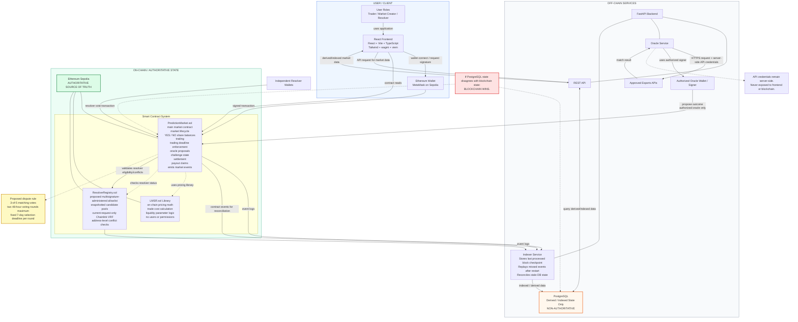
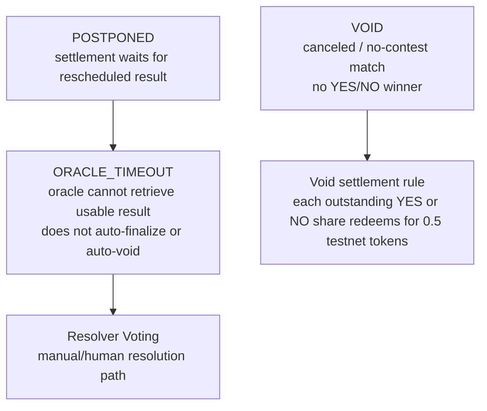

# AC_ON Architecture Preview

AC_ON is a testnet-only decentralized esports prediction market. Users connect an Ethereum wallet and trade YES/NO shares on binary esports match outcomes.

Milestone 3 market creation, LMSR quotes, and guarded buys are deployed on Ethereum Sepolia, with a confirmed ten-share YES smoke test. The [deployment manifest](../deployments/sepolia-m3.json) and [verification record](../contracts/deployments/sepolia-m3-2026-10-21/README.md) identify the live contracts and trade. The frontend implements the M3 quote/buy, position, indexed-data, and submitted/mined/indexed flows, and the complete browser-to-contract-to-indexer-to-API path has been verified locally on Anvil. Hosted Sepolia indexer/API operation and deployed-frontend acceptance remain pending. Off-chain services support indexing, PostgreSQL derived data, and FastAPI queries; esports APIs and oracle automation remain future work. The system is not fully trustless or fully permissionless.

## Main System Architecture

This diagram is the **target product architecture**, including future resolution components. The deployed M3 subset is ACON-funded market creation, internal LMSR pricing, guarded buys, positions, and events. Oracle proposals, challenges, resolver registry/voting, settlement, and claims are not deployed. See the [current implementation architecture](agent/ARCHITECTURE.md) for the verified M3 path and remaining integration work.



### Authorization Notes

- The oracle may propose outcomes through an authorized oracle wallet.
- The oracle may not directly settle disputed markets, bypass the challenge period, or vote as a human resolver.
- Resolver wallets are independent from the automated oracle.
- Resolver voting authorization is enforced by contracts:
  - active resolver
  - selected for the dispute
  - no prohibited conflict
- The proposal assigns resolver-allowlist administration to a project-team multisignature wallet. Admissions and removals emit events, and changes after a round snapshots its candidates affect later rounds rather than the pending selection.
- The market creator, result proposer, challenger, and any address recorded as having traded in or holding a position in the market must not resolve that market. These checks cannot identify undisclosed related wallets.
- Resolvers cast direct transactions from their selected addresses. Relayed voting is not part of the initial design; if added later, it must support ECDSA and EIP-1271 validation.

### On-Chain Contract Split

- `PredictionMarket.sol` is the main user-facing contract for market state, trading, disputes, settlement, and claims.
- `LMSR.sol` is a Solidity library used by `PredictionMarket.sol` for on-chain pricing math. It is not an off-chain service and users do not call it directly.
- `ResolverRegistry.sol` stores the allowlisted resolver pool and resolver eligibility rules. `PredictionMarket.sol` checks it when resolver votes are submitted.

### Database Authority And Recovery

- PostgreSQL stores derived/indexed data only.
- PostgreSQL may contain market lists, price history, trade history, resolver history, and derived market metadata.
- PostgreSQL must not be presented as the source of truth.
- The indexer should resume from the last processed block, replay missed events, and repair stale derived state.
- PostgreSQL does not write authoritative state into smart contracts.

## Market State Machine

The diagram below is the future lifecycle design. The deployed M3 contract creates markets directly in `OPEN` after collecting the subsidy. It rejects quotes/buys at the trading deadline while the stored state remains `OPEN`; it does not implement the close/resolution transitions shown here.

```mermaid
stateDiagram-v2
  [*] --> CREATED
  CREATED --> OPEN: market activated
  OPEN --> CLOSED: trading deadline reached
  CLOSED --> PROPOSED: oracle proposes result
  CLOSED --> ORACLE_TIMEOUT: oracle cannot retrieve usable result
  CLOSED --> VOID: canceled / no-contest match

  PROPOSED --> FINALIZED: challenge window expires
  PROPOSED --> DISPUTED: valid challenge
  DISPUTED --> RESOLVER_SELECTION: open round 1; set fixed 7-day deadline
  ORACLE_TIMEOUT --> RESOLVER_SELECTION: open round 1; set fixed 7-day deadline
  RESOLVER_SELECTION --> RESOLVER_VOTING: snapshot candidates; current VRF request selects 5
  RESOLVER_SELECTION --> VOID: no valid committee by fixed deadline
  RESOLVER_VOTING --> FINALIZED: 3-of-5 matching votes in round 1
  RESOLVER_VOTING --> RESOLVER_RESELECTION: no quorum after 48 hours
  RESOLVER_RESELECTION --> RESOLVER_REVOTE: open round 2; snapshot and select replacement
  RESOLVER_RESELECTION --> VOID: no valid replacement by fixed deadline
  RESOLVER_REVOTE --> FINALIZED: 3-of-5 matching votes in round 2
  RESOLVER_REVOTE --> VOID: no quorum after 48 hours
  FINALIZED --> CLAIMABLE: winning positions redeemable
```

### Exceptional States



`ORACLE_TIMEOUT` means the system does not have a reliable result yet. It does not silently choose a winner or immediately become `VOID`; it opens the same proposed resolver-selection path used by a challenged result. Each selection round stores a fixed seven-day deadline when the round opens. A failed or delayed VRF request may be retried, but retries reuse the candidate snapshot and cannot extend the deadline. `VOID` is reached only if no valid current request installs a five-resolver committee by that deadline, or a replacement committee fails to reach three matching votes during its 48-hour voting round.

## Proposed Resolver Protocol Decision

- A project-team multisignature wallet would control admission to and removal from the on-chain resolver allowlist. Every registry change emits an event. This administrator model and the Chainlink VRF dependency require explicit team approval.
- A challenged result or unusable oracle result opens selection round 1; a first voting round without quorum opens the single replacement selection round. Each round stores one fixed seven-day deadline when it opens, and retries cannot reset it.
- Creator, oracle proposer, challenger, trader, and position-holder addresses for the market are excluded. Enforcement is address-based and cannot detect an undisclosed related wallet.
- Before the first VRF request in a round, the contract snapshots at least five eligible, non-conflicted candidates. Registry changes after the snapshot apply only to later rounds, and retries reuse the same snapshot. The replacement round takes a new snapshot and excludes first-round resolvers when the pool permits.
- Chainlink VRF on Sepolia selects five distinct addresses from the snapshot. The contract stores one current request ID per market and round; a retry replaces that ID without changing the snapshot or deadline.
- Only a current request matching the pending market and round may install a committee before the deadline. Superseded, duplicate, mismatched, or late callbacks emit an ignored-fulfillment event and make no state change.
- A resolver may submit one direct on-chain vote for `YES`, `NO`, or `VOID` per round. Three matching votes finalize the market.
- If no valid committee exists by a selection round's fixed deadline, any account may trigger `VOID`. A replacement voting round that ends without quorum also becomes `VOID`.
- Direct voting relies on transaction sender authorization. A future relayed-vote path must support both ECDSA and EIP-1271 signatures.

These are proposed design rules for Milestone 4, not approved or deployed Milestone 3 behavior. The team must explicitly approve the administrator, Chainlink VRF, selection, and liveness rules. Exact contract functions, events, VRF retry delay/configuration, settlement, payouts, and complete `VOID` accounting remain to be implemented and tested.

## Trust Model

- Core trading and settlement rules are enforced on-chain.
- External esports APIs remain trusted off-chain dependencies.
- Initial approved APIs are configured by the project team.
- The automated oracle proposes outcomes but cannot unilaterally settle challenged markets.
- The proposal has a project-team multisignature wallet bootstrap and maintain the resolver pool; this trust assumption still requires team approval.
- Disputes are decided by multiple resolvers, not one centralized operator.
- The proposal uses snapshotted candidate pools and current-request-only Chainlink VRF fulfillment to select five eligible resolvers per voting round.
- Three matching votes are required.
- One replacement committee is allowed before terminal `VOID` fallback.
- Oracle and human resolver are separate actors.

## Authority Table

| Data / Action | Authoritative Source |
| --- | --- |
| Market state | Ethereum Sepolia smart contracts |
| YES/NO ownership | Ethereum Sepolia smart contracts |
| LMSR pricing/trades | Ethereum Sepolia smart contracts |
| Resolver votes | Ethereum Sepolia smart contracts |
| Settlement | Ethereum Sepolia smart contracts |
| Payout status | Ethereum Sepolia smart contracts |
| Esports match result input | Approved external APIs via oracle |
| Market list cache | PostgreSQL |
| Price/trade history cache | PostgreSQL |
| UI display state | Derived from chain/backend |

## Architecture Feedback Coverage

- [x] On-chain and off-chain boundaries
- [x] Blockchain state is authoritative
- [x] PostgreSQL is derived/indexed only
- [x] Oracle wallet authorization
- [x] Resolver authorization
- [x] API credential boundary
- [x] Stale indexer recovery
- [x] Database vs blockchain disagreement behavior
- [x] Oracle and resolver are separate actors
- [x] Market state-machine diagram
