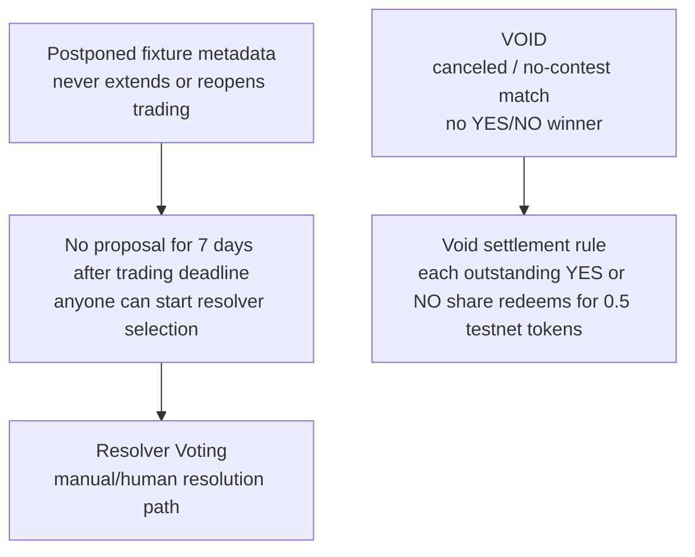

# AC_ON Architecture Preview

AC_ON is a testnet-only decentralized esports prediction market. Users connect an Ethereum wallet and trade YES/NO shares on binary esports match outcomes.

Milestone 3 market creation, LMSR quotes, and guarded buys are deployed on Ethereum Sepolia, with a confirmed ten-share YES smoke test. The [deployment manifest](../deployments/sepolia-m3.json) and [verification record](../contracts/deployments/sepolia-m3-2026-10-21/README.md) identify the live contracts and trade. The frontend implements the M3 quote/buy, position, indexed-data, and submitted/mined/indexed flows, and the complete browser-to-contract-to-indexer-to-API path has been verified locally on Anvil. Hosted Sepolia indexer/API operation and deployed-frontend acceptance remain pending. Off-chain services support indexing, PostgreSQL derived data, and FastAPI queries; esports APIs and oracle automation remain future work. The system is not fully trustless or fully permissionless.

## Main System Architecture

This diagram is the **M4 target architecture**, including fixture and resolution components. The deployed M3 subset is ACON-funded creation, LMSR pricing, guarded buys, positions, and events. Fixture registration, sells, oracle proposals, challenges, resolver voting, settlement, and claims are not deployed. See the [M4 design decision](agent/interfaces/M4_FEATURE_COMPLETE_INTERFACE.md) and [current implementation architecture](agent/ARCHITECTURE.md).

```mermaid
flowchart TB
  user["User Roles<br/>Trader / Market Creator / Resolver"]
  frontend["React Frontend<br/>React + Vite + TypeScript<br/>Tailwind + wagmi + viem"]
  wallet["Ethereum Wallet<br/>MetaMask on Sepolia"]

  subgraph client["USER / CLIENT"]
    user
    frontend
    wallet
  end

  subgraph offchain["OFF-CHAIN SERVICES"]
    api["FastAPI Backend"]
    rest["REST API"]
    oracle["Oracle Service"]
    catalog["Fixture Catalog<br/>manual JSON + deterministic mock<br/>optional permitted PandaScore"]
    registrarWallet["Restricted Fixture Registrar"]
    indexer["Indexer Service<br/>Stores last processed block checkpoint<br/>Replays missed events after restart<br/>Reconciles stale DB state"]
    oracleWallet["Authorized Oracle Wallet / Signer"]
    db["PostgreSQL<br/>Derived / Indexed State Only<br/>NON-AUTHORITATIVE"]
    esports["Organizer evidence URLs/hashes<br/>optional permitted API"]

    api --- rest
    api --- oracle
    api --- indexer
  end

  subgraph onchain["ON-CHAIN / AUTHORITATIVE STATE"]
    base["Ethereum Sepolia<br/>AUTHORITATIVE SOURCE OF TRUTH"]

    subgraph contracts["Smart Contract System"]
      market["PredictionMarket.sol<br/>main market contract<br/>market lifecycle<br/>YES / NO share balances<br/>trading<br/>trading deadline enforcement<br/>oracle proposals<br/>challenge state<br/>settlement<br/>payout claims<br/>emits market events"]
      fixtures["Fixture Registry<br/>one market per registered match<br/>YES Team A / NO Team B"]
      lmsr["LMSR.sol Library<br/>on-chain pricing math<br/>trade cost calculation<br/>liquidity parameter logic<br/>no users or permissions"]
      resolver["Resolver Registry<br/>2-of-3 Safe-administered allowlist<br/>snapshotted candidate pools<br/>current-request-only Chainlink VRF<br/>address-level conflict checks"]
    end

    base --- market
    base --- lmsr
    base --- resolver
  end

  resolverWallets["Resolver-only testnet addresses<br/>at least 10; four human controllers"]
  apiNote["API credentials remain server-side.<br/>Never exposed to frontend or blockchain."]
  chainWins["If PostgreSQL state disagrees with blockchain state:<br/>BLOCKCHAIN WINS."]
  disputeRule["M4 design rule<br/>3 YES/NO votes → FINALIZED; 3 VOID votes → VOID<br/>two 48-hour voting rounds maximum<br/>fixed 7-day selection deadline per round"]

  user -->|"uses application"| frontend
  frontend -->|"wallet connect / request signature"| wallet
  wallet -->|"signed transaction"| market
  frontend -->|"contract reads"| market
  frontend -->|"API request for market data"| rest
  frontend -->|"browse imported fixtures"| catalog
  rest -->|"derived/indexed market data"| frontend

  rest <-->|"query derived/indexed data"| db
  market -->|"event logs"| indexer
  resolver -->|"event logs"| indexer
  indexer -->|"indexed / derived data"| db
  market -->|"contract events for reconciliation"| indexer
  market -.->|"uses pricing library"| lmsr
  market -.->|"checks resolver status"| resolver

  oracle -->|"HTTPS request + server-side API credentials"| esports
  esports -->|"fixture/result evidence"| catalog
  catalog -->|"selected verified fixtures"| registrarWallet
  registrarWallet -->|"register fixture transaction"| fixtures
  market -->|"check registered fixture"| fixtures
  esports -->|"match result"| oracle
  oracle -->|"uses authorized signer"| oracleWallet
  oracleWallet -->|"propose outcome<br/>authorized oracle only"| market
  oracle -.-> apiNote

  resolverWallets -->|"resolver vote transaction"| market
  market -->|"validates resolver eligibility/conflicts"| resolver
  market -.-> disputeRule
  chainWins -.-> db
  chainWins -.-> market

  style client fill:#eef6ff,stroke:#2563eb,stroke-width:1px
  style offchain fill:#f8fafc,stroke:#64748b,stroke-width:1px
  style onchain fill:#ecfdf5,stroke:#059669,stroke-width:1px
  style db fill:#fff7ed,stroke:#ea580c,stroke-width:2px
  style base fill:#dcfce7,stroke:#15803d,stroke-width:2px
  style chainWins fill:#fee2e2,stroke:#dc2626,stroke-width:2px
  style disputeRule fill:#fef9c3,stroke:#ca8a04,stroke-width:2px
```



### Authorization Notes

- The oracle may propose outcomes through an authorized oracle wallet.
- The fixture registrar and outcome proposer are separate restricted roles with separate Yudhveer-operated keys. The backend imports fixtures; users create markets from selected registrations.
- The oracle may not directly settle disputed markets, bypass the challenge period, or vote as a human resolver.
- Resolver-only addresses do not register fixtures, create markets, trade, propose, or challenge. Four teammates control at least ten addresses, so this is address-level rather than human-level decentralization.
- Resolver voting authorization is enforced by contracts:
  - active resolver
  - selected for the dispute
  - no prohibited conflict
- A 2-of-3 Sepolia Safe controlled by Benny, Matthew, and Adriel owns allowlist administration, role recovery, and VRF subscription. Registry changes after a round snapshots candidates affect later rounds.
- The creator, fixture registrar, proposer, challenger, resolver admin, and any address recorded as trading in or holding a position in the market must not resolve it. These checks cannot identify undisclosed related wallets.
- Resolvers cast direct transactions from their selected addresses. Relayed voting is not part of the initial design; if added later, it must support ECDSA and EIP-1271 validation.

### On-Chain Contract Split

- `PredictionMarket.sol` is the main user-facing contract for market state, trading, disputes, settlement, and claims.
- `LMSR.sol` is a Solidity library used by `PredictionMarket.sol` for on-chain pricing math. It is not an off-chain service and users do not call it directly.
- `ResolverRegistry.sol` stores the allowlisted resolver pool and resolver eligibility rules. `PredictionMarket.sol` checks it when resolver votes are submitted.

### Database Authority And Recovery

- PostgreSQL stores derived/indexed data only.
- PostgreSQL may contain market lists, price history, trade history, resolver history, and derived market metadata.
- PostgreSQL must not be presented as the source of truth.
- The indexer should resume from the last processed block, replay missed events, and repair stale derived state.
- PostgreSQL does not write authoritative state into smart contracts.

## Market State Machine

The diagram below shows the decided M4 target. The deployed M3 contract creates markets directly in `OPEN` and rejects trading at the deadline without a stored close transition. M4 stores only `OPEN`, `CLOSED`, `PROPOSED`, `DISPUTED`, `RESOLVER_SELECTION`, `RESOLVER_VOTING`, `FINALIZED`, and `VOID`; round 1/2 is a separate field. The challenge window is 24 hours.

```mermaid
stateDiagram-v2
  [*] --> OPEN: create from registered fixture
  OPEN --> CLOSED: close after trading deadline
  OPEN --> CLOSED: registrar early close with evidence
  CLOSED --> PROPOSED: proposer submits YES / NO / VOID
  CLOSED --> RESOLVER_SELECTION: no proposal 7 days after deadline; round 1

  PROPOSED --> FINALIZED: unchallenged YES / NO after 24 hours
  PROPOSED --> VOID: unchallenged VOID after 24 hours
  PROPOSED --> DISPUTED: first challenge + 10 ACON bond
  DISPUTED --> RESOLVER_SELECTION: open round 1; set fixed 7-day deadline
  RESOLVER_SELECTION --> RESOLVER_VOTING: current VRF request selects 5; round 1 or 2
  RESOLVER_SELECTION --> VOID: no valid committee by fixed deadline
  RESOLVER_VOTING --> FINALIZED: 3 YES or 3 NO votes
  RESOLVER_VOTING --> VOID: 3 VOID votes
  RESOLVER_VOTING --> RESOLVER_SELECTION: round 1 no quorum after 48 hours; open round 2
  RESOLVER_VOTING --> VOID: round 2 no quorum after 48 hours
```

`FINALIZED` and `VOID` each allow claims. `CLAIMABLE` is a derived read based on terminal state, unclaimed positions, and claimed status; it is not stored.

### Exceptional States



Neither `POSTPONED` nor `ORACLE_TIMEOUT` is a stored market state. Each selection round has a fixed seven-day deadline; 30-minute VRF retries reuse its snapshot and cannot extend it. `VOID` follows three VOID votes, a committee-selection deadline without a committee, or round 2 without quorum.

## Resolver Protocol Decision

- The 2-of-3 Sepolia Safe controls the allowlist. Registry changes emit events. Chainlink VRF v2.5 uses one random word, three block confirmations, and test LINK billing.
- A challenged result or seven days without a proposal after the trading deadline opens selection round 1; a first voting round without quorum opens the single replacement selection round. Each round stores one fixed seven-day deadline when it opens, and retries cannot reset it.
- Creator, fixture registrar, proposer, challenger, trader, position-holder, and resolver-admin addresses are excluded. Enforcement is address-based and cannot detect an undisclosed related wallet.
- Before the first VRF request in a round, the contract snapshots at least five eligible, non-conflicted candidates. Retries after 30 minutes reuse that snapshot and deadline. Round 2 takes a new snapshot and excludes round-1 resolvers if five alternatives exist; otherwise still-eligible round-1 resolvers may be reused.
- Chainlink VRF on Sepolia selects five distinct addresses from the snapshot. The contract stores one current request ID per market and round; a retry replaces that ID without changing the snapshot or deadline.
- Only a current request matching the pending market and round may install a committee before the deadline. Superseded, duplicate, mismatched, or late callbacks emit an ignored-fulfillment event and make no state change.
- A resolver may submit one direct on-chain vote for `YES`, `NO`, or `VOID` per round. Three matching YES or NO votes finalize that winner; three matching VOID votes make the market VOID and enable VOID claims.
- If no valid committee exists by a selection round's fixed deadline, any account may trigger `VOID`. A replacement voting round that ends without quorum also becomes `VOID`.
- Direct voting relies on transaction sender authorization. A future relayed-vote path must support both ECDSA and EIP-1271 signatures.

These are the supplied M4 design decisions, not deployed behavior. Exact Solidity ABI types/indexed fields, contracts, and complete payout accounting remain to be implemented and tested. PR #28 must record approving members before it leaves Draft.

## Trust Model

- Core trading and settlement rules are enforced on-chain.
- Manual JSON fixture/result records and organizer evidence are the required no-cost source path; optional PandaScore use requires written permission.
- The automated oracle proposes outcomes but cannot unilaterally settle challenged markets.
- A 2-of-3 Sepolia Safe bootstraps and maintains the resolver pool.
- Disputes are decided by multiple resolvers, not one centralized operator.
- The M4 design uses snapshotted candidate pools and current-request-only Chainlink VRF fulfillment to select five eligible resolvers per voting round.
- Three matching YES/NO votes finalize a winner; three matching VOID votes make the market VOID.
- One replacement committee is allowed before terminal `VOID` fallback.
- Oracle and human resolver are separate actors.

## Authority Table

| Data / Action | Authoritative Source |
| --- | --- |
| Market state | Ethereum Sepolia smart contracts |
| YES/NO ownership | Ethereum Sepolia smart contracts |
| LMSR pricing/trades | Ethereum Sepolia smart contracts |
| Resolver votes | Ethereum Sepolia smart contracts |
| Settlement | Ethereum Sepolia smart contracts |
| Payout status | Ethereum Sepolia smart contracts |
| Esports match result input | Manual JSON and organizer evidence; optional permitted API via oracle |
| Market list cache | PostgreSQL |
| Price/trade history cache | PostgreSQL |
| UI display state | Derived from chain/backend |

## Architecture Feedback Coverage

- [x] On-chain and off-chain boundaries
- [x] Blockchain state is authoritative
- [x] PostgreSQL is derived/indexed only
- [x] Oracle wallet authorization
- [x] Resolver authorization
- [x] API credential boundary
- [x] Stale indexer recovery
- [x] Database vs blockchain disagreement behavior
- [x] Oracle and resolver are separate actors
- [x] Market state-machine diagram
